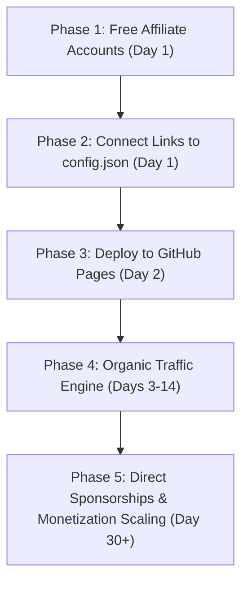

# Master Playbook: Launching & Monetizing Your Automated Deals Tool ($0 Cost)

This step-by-step operational roadmap transforms your local [`dealpulse-aggregator`](file:///C:/Users/VHPL-1033/.gemini/antigravity/scratch/dealpulse-aggregator) tool into a live, revenue-generating web application without spending a single dollar on infrastructure.

---

## High-Level Execution Phases



---

## Phase 1: Set Up Free Monetization Accounts (Day 1)

Before launching the site, register for the following **100% free-to-join** partner networks that match our developer tool and cloud credits niche:

### 1. DigitalOcean Referral Program
* **Sign Up**: [cloud.digitalocean.com/referrals](https://cloud.digitalocean.com/referrals) (Free)
* **Value to User**: Gives visitors **\$200 in free 60-day cloud credits** (huge conversion driver).
* **Payout to You**: **\$25 cash** for every referred user who stays active and spends \$25 after trial credits.
* **Your Link Format**: `https://m.do.co/c/YOUR_REFERRAL_CODE`

### 2. AppSumo / Impact Radius Affiliate Network
* **Sign Up**: [impact.com](https://impact.com) or [appsumo.com/affiliates](https://appsumo.com/affiliates)
* **Value to User**: Lifetime deals on AI software, productivity tools, and marketing suites (up to 90% off).
* **Payout to You**: **15% to 25% commission** per transaction (averaging \$10–\$50 per sale).
* **Your Link Format**: Generated automatically inside the Impact portal.

### 3. PartnerStack (Developer & B2B SaaS)
* **Sign Up**: [partnerstack.com](https://partnerstack.com)
* **Products to Promote**: Supabase, Webflow, Notion, Make.com, Brevo.
* **Payout to You**: **20% to 30% monthly recurring commissions** for each subscriber.

### 4. Stripe Payment Link or Lemon Squeezy (For Paid Sponsorships)
* **Sign Up**: [stripe.com](https://stripe.com) or [lemonsqueezy.com](https://lemonsqueezy.com) (Both free to create; they only take a 3-5% fee when you actually make a sale).
* **Create a Payment Link**: Create a single payment link titled *"Featured Tool Sponsorship (30 Days)"* priced at **\$29.00**.

---

## Phase 2: Insert Your Real Links into the Code (Day 1)

1. Open [`config.json`](file:///C:/Users/VHPL-1033/.gemini/antigravity/scratch/dealpulse-aggregator/config.json) in your project directory.
2. In the `featured_deals` array, replace the placeholder URLs with your actual affiliate links obtained in Phase 1:
   ```json
   {
     "title": "DigitalOcean $200 Cloud Credits (60-Day Trial)",
     "url": "https://m.do.co/c/YOUR_ACTUAL_CODE",
     ...
   }
   ```
3. Open [`templates/index.html`](file:///C:/Users/VHPL-1033/.gemini/antigravity/scratch/dealpulse-aggregator/templates/index.html) and search for `https://buy.stripe.com/test_placeholder_devdeals`. Replace it with your Stripe or Lemon Squeezy payment link for the \$29 tool promotion slot.

4. Run the local build script to update the site with your links:
   ```powershell
   cd C:\Users\VHPL-1033\.gemini\antigravity\scratch\dealpulse-aggregator
   py aggregator.py
   py build.py
   ```

---

## Phase 3: Deploy to GitHub Pages at Zero Cost (Day 2)

Deploy the repository to GitHub so it is publicly accessible, automatically updating on schedule, and indexed by search engines.

### 1. Create a Repository on GitHub
1. Log in to [github.com](https://github.com) and click **New Repository**.
2. Name it: `devstack-deals` (or any name you prefer).
3. Set visibility to **Public** (public repos get unlimited free GitHub Actions minutes).
4. Leave "Initialize with README" **unchecked**.

### 2. Push Code from PowerShell
Open PowerShell and run these commands:
```powershell
cd C:\Users\VHPL-1033\.gemini\antigravity\scratch\dealpulse-aggregator
& "C:\Users\VHPL-1033\AppData\Local\Programs\Git\bin\git.exe" remote add origin https://github.com/<YOUR-GITHUB-USERNAME>/devstack-deals.git
& "C:\Users\VHPL-1033\AppData\Local\Programs\Git\bin\git.exe" branch -M main
& "C:\Users\VHPL-1033\AppData\Local\Programs\Git\bin\git.exe" push -u origin main
```

### 3. Enable GitHub Pages Deployment
1. On your GitHub repository page, go to **Settings** > **Pages** (in the left sidebar).
2. Under **Build and deployment** > **Source**, change from *Deploy from a branch* to **GitHub Actions**.
3. Go to the **Actions** tab in your repository: you will see the `Automated Deals Aggregator & Publisher` workflow running automatically.
4. When finished (usually under 60 seconds), your site will be live at:
   `https://<YOUR-GITHUB-USERNAME>.github.io/devstack-deals/`

---

## Phase 4: Traffic Acquisition Engine (Days 3 to 14)

Traffic is the catalyst that drives revenue. Because this site provides **free tools, open-source software, and cloud credits**, developers welcome it as high-value content.

### Step 1: The "Show HN" Launch (Hacker News)
* **Where**: [news.ycombinator.com/submit](https://news.ycombinator.com/submit)
* **Format**:
  * **Title**: `Show HN: I made an automated directory of free cloud credits & open-source developer deals`
  * **Text**: Keep it humble, technical, and transparent. Mention the zero-cost architecture: *“Built a lightweight aggregator with pure Python and GitHub Actions that compiles static pages every 6 hours. Also added a client-side savings calculator. Would love feedback on feeds to add.”*
* **Expected Result**: 300 to 1,500 highly technical visitors in 24 hours.

### Step 2: The "Maker-to-Maker" Reverse Growth Loop (High-Conversion Strategy)
1. Search Twitter/X or LinkedIn for `#buildinpublic` or "Launched my tool on ProductHunt".
2. Find 15 indie developers who just launched developer tools or SaaS utilities.
3. Message them:
   > *"Hey [Name], loved seeing [Tool Name] launched today! I just indexed it inside our automated developer deals directory ([your-link]). Thought it was a great fit for our community. Let me know if you want the description tweaked!"*
4. **Why this works**: Founders are thrilled to be featured and frequently retweet or share the link with their existing audience, sending their followers to your site for free.

### Step 3: Targeted Reddit Communities
Share the project in these specific subreddits (focusing on feedback, not sales):
* `r/SideProject`
* `r/webdev`
* `r/selfhosted`
* `r/microsaas`
* **Headline idea**: *"I got tired of hunting for active cloud credits and student/indie discounts, so I wrote an open-source bot that aggregates them daily."*

### Step 4: Submit to GitHub "Awesome" Lists
Find curated repositories on GitHub such as:
* `awesome-developer-first`
* `awesome-selfhosted`
* `awesome-free-for-developers`
Submit a Pull Request linking your directory and calculator under the resources section. This provides permanent, high-domain-authority backlinks for SEO.

---

## Phase 5: Scale to Your First $1,000 / Month (Day 30+)

```
[ Audience Traffic: ~500 visits/day ]
         │
         ├── 1. Free Cloud Credit Signups (DigitalOcean)
         │      ↳ 10 signups/mo @ $25 = $250/mo
         │
         ├── 2. Software Lifetime Deals (AppSumo / Impact)
         │      ↳ 8 sales/mo @ $25 avg cut = $200/mo
         │
         ├── 3. Recurring SaaS Affiliates (PartnerStack / Supabase)
         │      ↳ 5 recurring accounts @ $20/mo = $100/mo (compounds)
         │
         └── 4. Direct Tool Sponsorships ($29/mo slot via Stripe)
                ↳ 4 indie tools sponsored = $116/mo
         ──────────────────────────────────────────────────────
         Target Revenue: $666 - $1,000+ / mo at $0 hosting expense
```

### Key Milestones Checklist

- [ ] Complete Phase 1: Register free affiliate accounts (DigitalOcean, AppSumo/Impact, PartnerStack).
- [ ] Complete Phase 2: Add links to `config.json` and rebuild (`py build.py`).
- [ ] Complete Phase 3: Push repository to GitHub and toggle GitHub Pages to GitHub Actions.
- [ ] Complete Phase 4: Submit Show HN, post on `r/SideProject`, and message 10 indie makers.
- [ ] Track traffic via Google Search Console or free privacy analytics (e.g., Cloudflare Web Analytics - $0).
